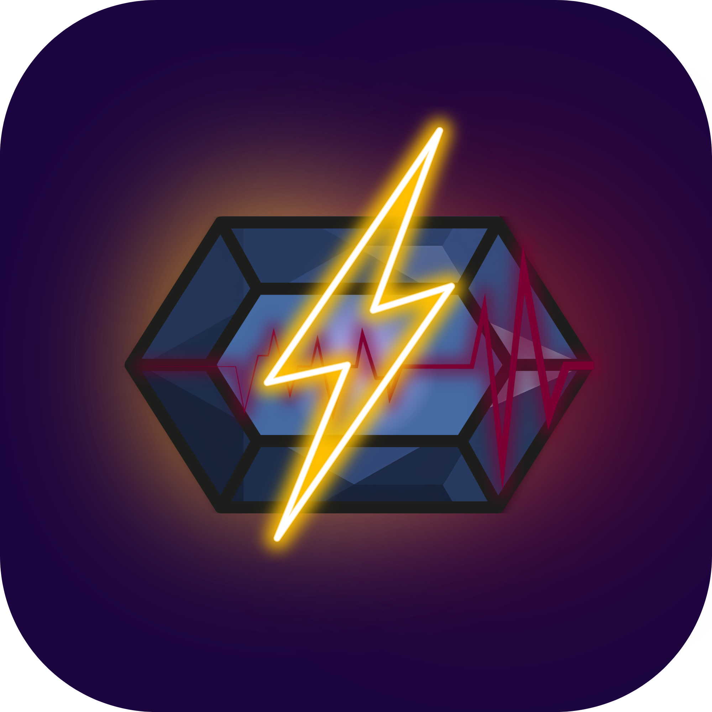

<div align="center">
  
  <h1>⚡ ActiQuest: Campus Fitness & Active Learning Quest System</h1>
</div>

[](https://android.com)
[](https://kotlinlang.org)
[](https://developer.android.com/jetpack/compose)
[](https://m3.material.io)
[](https://firebase.google.com)
[](LICENSE)

> **ActiQuest** is an open-source, gamified campus wellness and active learning platform designed for universities, colleges, and school physical education campaigns. It transforms daily campus walking and study breaks into interactive fitness quests, motivating students through landmark QR discoveries, motion proofs, verified point rewards, and inter-class leaderboard battles.

---

## 📱 System Overview

Traditional university wellness programs often struggle with low student engagement and cumbersome manual tracking. **ActiQuest** solves this by providing:

1. **Student Adventure Portal**:
   - **Landmark QR Quests**: Discover and scan QR code markers posted at physical campus hotspots (e.g., Side Gate area or around the BB lobby, building entrances, Track Oval).
   - **Activity Proof Engine**: Record short video proofs of completed exercises or upload screenshots from pedometers, fitness bands, or running apps (Steps, Active Minutes, 3KM runs).
   - **Academic Profile & Verified Changes**: Students can update their profile. Any change to academic assignment (College, Program, Year, Section) is sent to the Admin Verification Desk for verification so official class standings remain fair.
   - **Class Standing & College Battles**: Real-time leaderboards by College, Academic Program, Year Level, and Section.
   - **Milestone Badges**: Unlock achievement badges as workouts are reviewed and approved.
   - **Activity Journey**: Calendar-based streak tracking with weekly analytics.

2. **Admin Verification Desk (PE Faculty & Coordinators)**:
   - Dedicated, role-gated verification queue to inspect submitted exercise videos and fitness screenshots.
   - **Academic Change Requests**: Dedicated verification desk to approve or reject student class transfers and major shifts with official notes.
   - **Scoring Tools**: Approve with custom or full points, reject with personalized coaching notes, or request retakes.
   - Immediate point synchronization with student profiles and class totals in Firestore.
   - Live quest manager and campus-wide metrics summary.

---

## 📍 Campus Quest Catalog & Test QR Codes

Students unlock quests by scanning physical QR markers located across the campus. Below is the official quest catalog, including the **Side Gate Lunges** quest.

> 💡 **Try it Out**: Open the ActiQuest app, tap **Scan Quest QR** on the home screen, and point your camera directly at any of the QR codes below!

### 🌟 Featured Quest: Side Gate Lunges
- **Backend Quest Code**: `QQ-SIDEGATE` *(also accepts alias `QQ-SIDE-GATE`)*
- **Title**: Side Gate Lunges
- **Category**: Quick Quest (50 Points | 30s Cap)
- **Campus Location**: Side Gate Area / BB Lobby
- **Exercise**: Perform 12 walking lunges (6 per leg) at the side gate area or around the BB lobby walkway.
- **QR Code Content**: `QQ-SIDEGATE`

<div align="center">
  
  <p><b>Scan with ActiQuest:</b> <code>QQ-SIDEGATE</code></p>
</div>

---

### 📋 Full Campus Quest QR Roster

| Quest Code | Quest Title | Category | Pts | Location | Scan Marker (Direct QR) |
| :--- | :--- | :---: | :---: | :--- | :---: |
| `QQ-SIDEGATE` | **Side Gate Lunges** | Quick | 50 | Side Gate Area / BB Lobby | [View QR](https://api.qrserver.com/v1/create-qr-code/?size=200x200&data=QQ-SIDEGATE) |
| `QQ-DIOKNO` | **Diokno Steps** | Quick | 50 | Sen. Jose Diokno Entrance | [View QR](https://api.qrserver.com/v1/create-qr-code/?size=200x200&data=QQ-DIOKNO) |
| `QQ-CBEAM` | **CBEAM Stretch** | Quick | 50 | Outside CBEAM Hall | [View QR](https://api.qrserver.com/v1/create-qr-code/?size=200x200&data=QQ-CBEAM) |
| `QQ-SLOUNGE` | **South Lounge Squats** | Quick | 50 | South Lounge | [View QR](https://api.qrserver.com/v1/create-qr-code/?size=200x200&data=QQ-SLOUNGE) |
| `QQ-CANTEEN` | **Canteen Calorie Burn**| Quick | 50 | BB Canteen Area | [View QR](https://api.qrserver.com/v1/create-qr-code/?size=200x200&data=QQ-CANTEEN) |
| `QQ-MABINI` | **Mabini Mini Break** | Quick | 50 | Apolinario Mabini Hall | [View QR](https://api.qrserver.com/v1/create-qr-code/?size=200x200&data=QQ-MABINI) |
| `EQ-LRC` | **LRC Stair Climb** | Explorer | 100 | Diokno Bldg Stairwell | [View QR](https://api.qrserver.com/v1/create-qr-code/?size=200x200&data=EQ-LRC) |
| `EQ-NEXUS` | **Nexus Walk** | Explorer | 100 | Nexus Labs Walkway | [View QR](https://api.qrserver.com/v1/create-qr-code/?size=200x200&data=EQ-NEXUS) |
| `EQ-OVAL` | **Track Oval Lap** | Explorer | 100 | Campus Track Oval | [View QR](https://api.qrserver.com/v1/create-qr-code/?size=200x200&data=EQ-OVAL) |
| `AQ-RUN-START` | **3KM Run: Start** | Boss | 0 | Campus Oval Starting Arch | [View QR](https://api.qrserver.com/v1/create-qr-code/?size=200x200&data=AQ-RUN-START) |
| `AQ-RUN-FINISH`| **3KM Run: Finish**| Boss | 300 | Campus Oval Finish Arch | [View QR](https://api.qrserver.com/v1/create-qr-code/?size=200x200&data=AQ-RUN-FINISH) |

---

## 🛠️ Architecture & Tech Stack

```text
├── app/src/main/java/com/actiquest/
│   ├── MainActivity.kt               # Edge-to-edge system bars controller
│   ├── data/
│   │   ├── FirebaseManager.kt        # Auth, Firestore sync, local cache, academic requests & fallback
│   │   └── Repository.kt             # Clean singleton abstraction
│   ├── domain/
│   │   └── Models.kt                 # Quests, Submissions, Badges, AcademicChangeRequest, Colleges catalog
│   ├── ui/
│   │   ├── ActiQuestApp.kt           # NavHost & authentication routing
│   │   ├── components/               # Avatars, Cards, Badges, Video Player, Scanner
│   │   ├── screens/
│   │   │   ├── HomeScreen.kt         # Student dashboard, activity cards & feed
│   │   │   ├── LoginScreen.kt        # Role-isolated Student & Admin portals
│   │   │   ├── AdminReviewScreen.kt  # Verification desk, submissions & academic requests
│   │   │   ├── StudentSubmissions.kt # Submission status, feedback & retake
│   │   │   ├── ProfileSettings.kt    # User profile, theme toggle, academic change & About dialog
│   │   │   ├── ScanScreen.kt         # Real-time ZXing QR scanner
│   │   │   ├── RecordScreen.kt       # CameraX in-app video proof recorder
│   │   │   ├── StandingsScreen.kt    # Inter-class & college leaderboards
│   │   │   └── BadgesScreen.kt       # Milestone achievement gallery
│   │   └── theme/                    # Material 3 colors, typography & dark theme
```

- **Android Jetpack**: Compose, ViewModel, Navigation Compose, Coroutines & Flow.
- **Camera & Scanning**: CameraX for in-app video capture; ZXing Android Embedded for instant QR decoding.
- **Data & Auth**: Firebase Authentication (Email/Password) with Cloud Firestore real-time snapshot listeners.
- **Offline Resilient**: In-memory state and local fallback allow seamless testing even without internet connectivity.

---

## 🏫 How to Customize for Your Own School Campaign

Follow these steps to customize ActiQuest for your university, college, or corporate wellness campaign:

### 1. Update Colleges, Degree Programs & Sections
Open `app/src/main/java/com/actiquest/domain/Models.kt` and modify `CollegeCatalog`:
```kotlin
object CollegeCatalog {
    val COLLEGES = listOf(
        College(
            code = "CITE",
            name = "College of Information Technology and Engineering",
            programs = listOf("BS Information Technology", "BS Computer Science")
        ),
        College(
            code = "CBEAM",
            name = "College of Business, Economics, Accountancy & Management",
            programs = listOf("BS Accountancy", "BS Business Administration")
        )
        // Add your institution's colleges here
    )
}
```

### 2. Configure Your Campus Quests & Landmark Locations
In the same file (`app/src/main/java/com/actiquest/domain/Models.kt`), update `SeedQuests.QUEST_MAP`:
```kotlin
"QQ-SIDEGATE" to Quest(
    questCode = "QQ-SIDEGATE",
    title = "Side Gate Lunges",
    instructions = "Perform 12 walking lunges (6 per leg) at the side gate area or around the BB lobby walkway.",
    location = "Side Gate Area / BB Lobby",
    category = "quick",
    pointValue = 50,
    maxSeconds = 30,
    active = true
)
```

### 3. Print QR Markers for Campus Spots
Generate and print QR codes containing the `questCode` text (e.g. `QQ-SIDEGATE`). Laminate and mount them at the corresponding campus locations.

### 4. Setup Your Own Cloud Firestore & Firebase Auth

1. Go to the [Firebase Console](https://console.firebase.google.com/) and create a new project.
2. In **Authentication > Sign-in method**, enable **Email/Password**.
3. In **Firestore Database**, create a database in production mode.
4. Replace `app/google-services.json` with your project's configuration file.
5. In the **Rules** tab of Firestore, deploy the security rules:

```javascript
rules_version = '2';
service cloud.firestore {
  match /databases/{database}/documents {
    
    function isAdmin() {
      return request.auth != null && (
        exists(/databases/$(database)/documents/admins/$(request.auth.uid)) ||
        exists(/databases/$(database)/documents/admins/$(request.auth.token.email)) ||
        (exists(/databases/$(database)/documents/users/$(request.auth.uid)) && 
         get(/databases/$(database)/documents/users/$(request.auth.uid)).data.role == 'admin')
      );
    }

    match /users/{userId} {
      allow read: if request.auth != null;
      allow create, update: if request.auth != null && (request.auth.uid == userId || isAdmin());
    }

    match /admins/{docId} {
      allow read: if request.auth != null;
      allow write: if isAdmin();
    }

    match /submissions/{submissionId} {
      allow read: if request.auth != null && (
        resource.data.userId == request.auth.uid || isAdmin()
      );
      allow create: if request.auth != null && request.resource.data.userId == request.auth.uid;
      allow update: if isAdmin();
    }

    match /academic_requests/{requestId} {
      allow read: if request.auth != null;
      allow create: if request.auth != null && request.resource.data.userId == request.auth.uid;
      allow update: if isAdmin();
    }

    match /classes/{classId} {
      allow read: if request.auth != null;
      allow write: if isAdmin();
    }

    match /quests/{questId} {
      allow read: if request.auth != null;
      allow write: if isAdmin();
    }
  }
}
```

6. To authorize an administrator account, create a document in the `admins` collection with the admin's email or UID and set `role: "admin"`.

---

## 🚀 Building & Exporting the APK

### Prerequisites
- JDK 17+
- Android SDK (API 35)

### Build Debug APK
```bash
gradle :app:assembleDebug
```
The compiled APK will be generated at:
`app/build/outputs/apk/debug/app-debug.apk`

---

## 🔒 Security & Privacy Practices

- **Zero Hardcoded Secrets**: No confidential keys or sensitive credentials are stored in git.
- **Granular Firestore Rules**: Students can only view and submit their own activity proofs. Only authenticated faculty administrators can access the Verification Desk to grade points and verify academic changes.
- **Device Camera Access**: Camera access is requested strictly at runtime when opening the QR scanner or recording motion proof.

---

## 📄 License & Credits

Distributed under the [MIT License](LICENSE).
Copyright (c) 2026 ActiQuest Contributors & Campus Wellness Initiative.
See [LICENSE](LICENSE) for full details.
